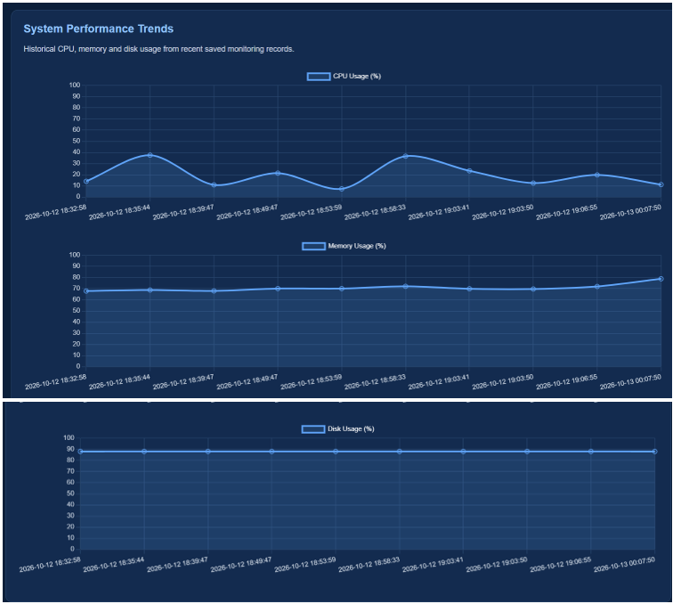

# IT Infrastructure Monitoring Dashboard

A Python-based IT infrastructure monitoring dashboard that monitors system health, checks network connectivity, detects service availability, and generates alerts for potential infrastructure issues.

## Project Overview

This project demonstrates basic IT infrastructure monitoring concepts through a web-based dashboard built with Flask. It provides a centralized view of system performance, network diagnostics, service availability, and recent monitoring history.


## Features

- **System Health Monitoring:** CPU usage, memory usage, disk usage, and available storage.
- **Network Diagnostics:** DNS resolution and connectivity checks.
- **HTTPS Service Check:** Checks whether a remote TCP service is reachable on port 443.
- **Alert Management:** Generates alerts based on configurable CPU, memory, disk, DNS, and connectivity thresholds.
- **Performance Charts:** Visualizes monitoring metrics through charts.
- **Monitoring History:** Stores historical snapshots in an SQLite database.
- **CSV Export:** Downloads monitoring history for further analysis.
- **Automated Tests:** Tests alert logic using simulated inputs.

## Technologies Used

- Python
- Flask
- psutil
- SQLite
- HTML and CSS
- JavaScript and Chart.js
- Git and GitHub

## Project Structure

```text
IT-Infrastructure-Monitor/
├── app.py
├── monitor.py
├── network_check.py
├── service_check.py
├── alerts.py
├── database.py
├── test_alerts.py
├── requirements.txt
├── .gitignore
└── README.md
```

## Getting Started

### 1. Clone the repository

```bash
git clone https://github.com/Palak-2008/IT-Infrastructure-Monitor.git
cd IT-Infrastructure-Monitor
```

### 2. Create a virtual environment

```bash
python -m venv venv
```

Activate it on Windows PowerShell:

```powershell
.\venv\Scripts\Activate.ps1
```

### 3. Install dependencies

```bash
pip install -r requirements.txt
```

### 4. Start the dashboard

```bash
python app.py
```

Open the local URL displayed in the terminal, typically:

`http://127.0.0.1:5000`

## Alert Thresholds

| Metric | Warning | Critical |
|---|---:|---:|
| CPU usage | 80% | 90% |
| Memory usage | 85% | 95% |
| Disk usage | 90% | 95% |

DNS resolution failures generate critical alerts, while failed connectivity checks generate warnings.

## Running the Tests

Run the alert logic tests with:

```bash
python test_alerts.py
```

The tests use simulated monitoring data to validate alert conditions.

## Learning Outcomes

- Understanding operating system resource monitoring.
- Performing basic network and service availability checks.
- Implementing threshold-based alerting.
- Persisting monitoring data using SQLite.
- Building a Flask-based monitoring dashboard.
- Testing application logic and managing source code with Git.

## Future Improvements

- Integrate a SIEM platform for centralized security monitoring.
- Add email notifications for critical alerts.
- Implement user authentication and role-based access.
- Add configurable monitoring intervals and alert thresholds.
- Support monitoring multiple remote systems.

## Author

**Palak Parmar**

[GitHub Profile](https://github.com/Palak-2008)
