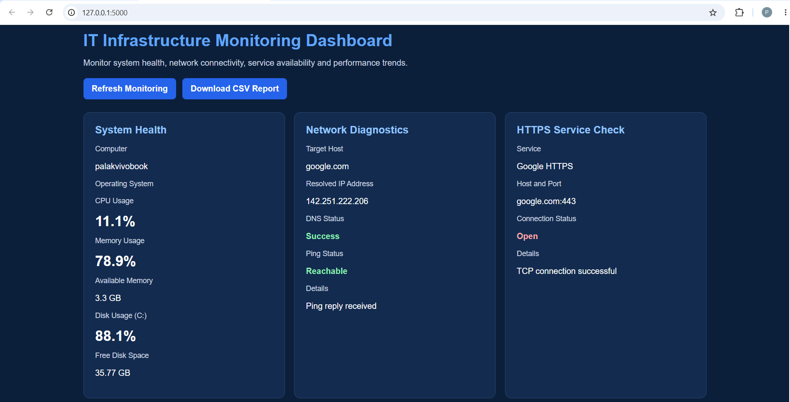
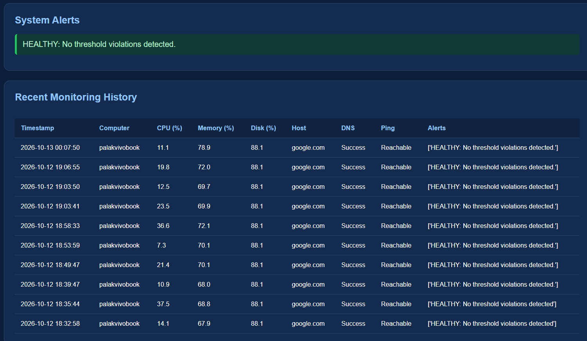

# IT Infrastructure Monitoring Dashboard

A Python-based IT infrastructure monitoring dashboard that monitors system health, checks network connectivity, detects service availability, and generates alerts for potential infrastructure issues.

## Project Overview

This project demonstrates basic IT infrastructure monitoring concepts through a web-based dashboard built with Flask. It provides a centralized view of system performance, network diagnostics, service availability, and recent monitoring history.

## Features

- **System Health Monitoring:** CPU usage, memory usage, disk usage, and available storage.
- **Network Diagnostics:** DNS resolution and connectivity checks.
- **HTTPS Service Check:** Checks whether a remote TCP service is reachable on port 443.
- **Alert Management:** Generates alerts based on configurable CPU, memory, disk, DNS, and connectivity thresholds.
- **Performance Charts:** Visualizes monitoring metrics through charts.
- **Monitoring History:** Stores historical snapshots in an SQLite database.
- **CSV Export:** Downloads monitoring history for further analysis.
- **Automated Tests:** Tests alert logic using simulated inputs.

## Technologies Used

- Python
- Flask
- psutil
- SQLite
- HTML and CSS
- JavaScript and Chart.js
- Git and GitHub

## Project Structure

```text
IT-Infrastructure-Monitor/
├── app.py
├── monitor.py
├── network_check.py
├── service_check.py
├── alerts.py
├── database.py
├── test_alerts.py
├── requirements.txt
├── .gitignore
└── README.md
```

## Getting Started

### 1. Clone the repository

```bash
git clone https://github.com/Palak-2008/IT-Infrastructure-Monitor.git
cd IT-Infrastructure-Monitor
```

### 2. Create a virtual environment

```bash
python -m venv venv
```

Activate it on Windows PowerShell:

```powershell
.\venv\Scripts\Activate.ps1
```

### 3. Install dependencies

```bash
pip install -r requirements.txt
```

### 4. Start the dashboard

```bash
python app.py
```

Open the local URL displayed in the terminal, typically:

`http://127.0.0.1:5000`

## Alert Thresholds

| Metric | Warning | Critical |
|---|---:|---:|
| CPU usage | 80% | 90% |
| Memory usage | 85% | 95% |
| Disk usage | 90% | 95% |

DNS resolution failures generate critical alerts, while failed connectivity checks generate warnings.

## Running the Tests

Run the alert logic tests with:

```bash
python test_alerts.py
```

The tests use simulated monitoring data to validate alert conditions.

## Learning Outcomes

- Understanding operating system resource monitoring.
- Performing basic network and service availability checks.
- Implementing threshold-based alerting.
- Persisting monitoring data using SQLite.
- Building a Flask-based monitoring dashboard.
- Testing application logic and managing source code with Git.

## Future Improvements

- Integrate a SIEM platform for centralized security monitoring.
- Add email notifications for critical alerts.
- Implement user authentication and role-based access.
- Add configurable monitoring intervals and alert thresholds.
- Support monitoring multiple remote systems.

## Author

**Palak Parmar**

[GitHub Profile](https://github.com/Palak-2008)

# IT Infrastructure Monitoring Dashboard

A Python-based IT infrastructure monitoring application that tracks system resource usage, checks network connectivity, monitors HTTPS service availability, and generates severity-based alerts through a web dashboard.

## Project Overview

This project demonstrates basic IT infrastructure monitoring concepts using Python, Flask, and SQLite. It provides a centralized dashboard to view system health, network diagnostics, performance trends, and recent monitoring history.

## Dashboard Screenshots

### 1. Dashboard Overview


### 2. System Alerts and Monitoring History


### 3. System Performance Trends


## Features

- **System Health Monitoring:** Displays CPU usage, memory usage, available memory, disk utilization, and free disk space.
- **Network Diagnostics:** Checks DNS resolution and network reachability.
- **HTTPS Service Check:** Tests TCP connectivity to Google on port 443.
- **Performance Visualization:** Displays CPU, memory, and disk usage trends using Chart.js.
- **Severity-Based Alerts:** Identifies healthy conditions, warnings, and critical threshold violations.
- **Monitoring History:** Stores system and network snapshots in an SQLite database.
- **CSV Report Export:** Downloads saved monitoring records for reporting and analysis.
- **Web Dashboard:** Provides a centralized interface built with Flask.

## Technologies Used

| Technology | Purpose |
|---|---|
| Python | Monitoring logic and application backend |
| Flask | Web application and dashboard |
| psutil | System resource monitoring |
| SQLite | Monitoring history storage |
| Chart.js | Performance charts |
| HTML and CSS | Dashboard structure and styling |
| CSV | Exporting monitoring reports |
| Git and GitHub | Version control and project hosting |

## Project Structure

```text
IT-Infrastructure-Monitor/
├── app.py
├── monitor.py
├── network_check.py
├── alerts.py
├── service_check.py
├── database.py
├── test_alerts.py
├── monitoring.db
├── README.md
└── requirements.txt
```

The `venv/` virtual environment is used locally and should not be uploaded to GitHub.

## Installation and Setup

### 1. Clone the repository

```bash
git clone YOUR_GITHUB_REPOSITORY_URL
cd IT-Infrastructure-Monitor
```

Replace `YOUR_GITHUB_REPOSITORY_URL` with your actual repository URL.

### 2. Create a virtual environment

```bash
python -m venv venv
```

Activate it on Windows PowerShell:

```powershell
.\venv\Scripts\Activate.ps1
```

### 3. Install dependencies

```bash
pip install -r requirements.txt
```

### 4. Run the application

```bash
python app.py
```

Open the following address in your browser:

```text
http://127.0.0.1:5000
```

## Alert Thresholds

| Metric | Warning | Critical |
|---|---:|---:|
| CPU usage | 80% | 90% |
| Memory usage | 85% | 95% |
| Disk usage | 90% | 95% |
| DNS resolution failure | — | Critical |
| Ping failure | Warning | — |

Thresholds are defined in `alerts.py`.

## Testing

Run the alert test script:

```bash
python test_alerts.py
```

The tests use simulated system and network values to verify healthy, warning, and critical alert behavior.

## Usage

1. Start the Flask application.
2. Open the dashboard in your browser.
3. Review system health and network diagnostics.
4. Inspect the performance charts and system alerts.
5. Refresh the dashboard to collect another monitoring snapshot.
6. Download a CSV report to analyze saved monitoring records.

## Current Limitations

- Monitoring snapshots are collected when the dashboard is refreshed; continuous background monitoring is not implemented.
- Network reachability checks depend on the target host and network configuration.
- Chart.js is loaded from a CDN and requires an internet connection to display charts.
- The HTTPS service check verifies TCP connectivity to port 443, not the full TLS certificate or application health.

## Future Enhancements

- Automatic background monitoring at configurable intervals.
- Email notifications for critical alerts.
- Configurable alert thresholds.
- More network service checks.
- Improved historical reports and filtering.
- Automated tests for system, network, and database modules.

## Learning Outcomes

This project demonstrates practical experience with:

- Operating system resource monitoring.
- Basic network troubleshooting.
- TCP service availability checks.
- Python application development.
- Flask web applications.
- SQLite database integration.
- Alert generation and functional testing.
- Performance visualization and CSV reporting.

## Author

**Palak Parmar**

MCA Student | Cybersecurity and IT Infrastructure

GitHub:  https://github.com/Palak-2008
LinkedIn: https://www.linkedin.com/in/palak-parmar-5640b8385/


